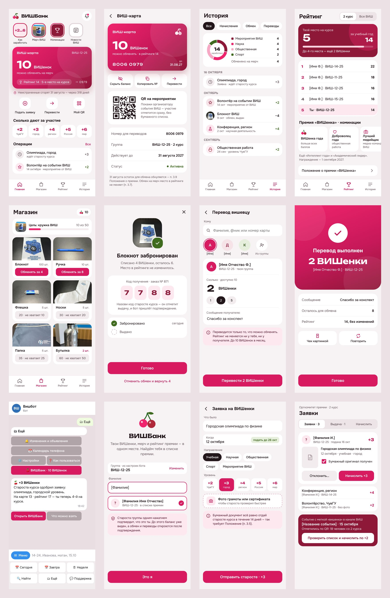

# ВИШБанк — концепция и макет (черновик v1, 17.10.2026)

Мини-приложение (Telegram Mini App) внутри вишбота: кошелёк премии «ВИШенка».
Баланс, ВИШ-карта, история, рейтинг и номинации, магазин мерча, заявки на начисление,
переводы между вишевцами (если разрешит Старостат). Цвет — вишнёвый и светло-малиновый.

Макет — 12 экранов в `screens/` (общий вид — `screens/00-overview.jpg`). Все цифры
и подписи на экранах демонстрационные; `[Имя Ф.]` — место для настоящих имён.

## 1. Что взято за основу

### Положение о премии «ВИШенка» (2025, Старостат ВИШ)
- Балл — «ВИШенка». Период — учебный год, 1 сентября — 31 августа (п. 3.1).
- Индивидуальный рейтинг = сумма заработанных ВИШенок (п. 3.3).
- Начисление — по бумажным документам, переданным старосте курса (потока) не позже 14 дней (п. 3.5).
  Баллы по уровню: ЧувГУ 2, город 3, регион 4, Россия 5, мир 6 (Приложение № 1).
- ВИШенки можно обменять на призы, количество ограничено (п. 3.6); обмен **не меняет место в рейтинге** (п. 3.7).
- Учёт доступных для обмена ведётся в электронном виде; 31 августа остаток **обнуляется** (п. 3.9).
- Штрафы — вычитание баллов, вычтенное «возвращается обратно в банк» (п. 3.11, 3.13).
  Выговор обнуляет рейтинг и баллы и запрещает копить до конца периода (п. 3.12). Отчисление обнуляет всё (п. 3.14).
- Номинации: «ВИШенка года», «Доброволец года», «Лучший медийщик», «Интеллект года», «Академический лидер».
  Награждение — 1 сентября следующего учебного года (п. 4.5).
- Переводов между студентами Положение **не предусматривает**.

### Таблица оргкомитета (Google Sheets)
- Листы «1/2/3 курс»: № · ФИО · группа · примечание («Староста») · столбец на каждый день
  01.09–30.12.**2025** · «Рейтинг» · «Количество ВИШенок». То есть это прошлый учебный год (2025/26).
- 289 студентов, у 55 есть баллы, максимум 22. «Рейтинг» и «Количество» почти везде равны: обменов в таблице не видно.
- «Логи по внесению и даты»: 104 записи. Поля: студент, курс, категория, баллы, дата внесения, дата мероприятия.
  103 из 104 записей — по 2 балла. Категории: общественная, научная, учебная, спортивная деятельность и «Мероприятие от ВИШ».
- «Остаток мерча»: блокнот 4, ручка 8, флешка 20, носки 30, папка 35, кружка 50, бутылка 60, стакан с крышкой 70.
  «Было» = «Осталось»: выдач не отмечено. Лист «Фото мерча» — 8 фото, они использованы в макете магазина.

### Канал ВИШ (t.me/vish_chuvsu)
- 20.10.2025: значок 🍒 в анонсе = за участие начисляют ВИШенки. Это готовый сигнал для ИИ-сканера новостей бота.
- 07.11.2025: официальный старт премии; документы — «старосте своего потока».
- 12.12.2025: первый обмен на подарки, по расписанию (час в аудитории).
- 07.03.2026: прайс — брелок 10, леденцы 6, ручка 3. Он **не совпадает** с листом «Остаток мерча» (ручка 8).
- За конкурсы в канале давали по 5 ВИШенок, то есть баллы начисляют и вне шкалы 2–6.
- Итогов 2025/26 и новой редакции Положения в открытых источниках на 17.10.2026 нет.
- Прообраз: у «ВИШенок» РУТ (МИИТ) есть онлайн-форма заявки и публичный рейтинг (wish.rut.digital/vishenki).

### СберБанк Онлайн — что берём, а что нет
Берём только **общие приёмы банковских приложений**, а не стиль Сбера (без зелёного, без SB Sans, без чужих иконок):
- баланс виден сразу при открытии, «глаз» скрывает его;
- один «кошелёк» (у нас одна карта);
- «Переводы»: недавние получатели и одно умное поле «фамилия / @ник / номер»; перед отправкой — имя получателя;
- история с разбивкой «откуда пришло»;
- «цель» с полосой прогресса (у нас — «коплю на кружку»);
- экран успеха с «Повторить» и чеком.

Не берём: пять вкладок, витрину сервисов, уровни лояльности (Сбер сам отказался от уровней «Спасибо» в 2024 году).

### Вишбот
- Есть Mini App: `GET /tma`, проверка подписи `verifyInitData`, HTTPS-адрес (`PUBLIC_URL` / запасной).
  Это форма «🎥 Записывать мою группу» в «🗂 Ещё» (решение № 113). ВИШБанк ложится на ту же основу.
- В `users` есть Telegram id и группа, но нет ФИО. Значит, нужна привязка «аккаунт ↔ строка премии».
- Реестры людей — только на сервере. Репозиторий публичный: в коде и логах — только id и цифры.

## 2. Экраны

| № | Экран | Зачем |
|---|---|---|
| 1 | Главная | ВИШ-карта с балансом, «сгорят через N дней», «Подать заявку · Перевести · Мой QR», шкала баллов, последние операции |
| 2 | ВИШ-карта | номер для переводов, QR для отметки на мероприятии, срок действия = 31 августа, статус |
| 3 | История | «откуда ВИШенки» по категориям; заявки, обмены, переводы по датам |
| 4 | Рейтинг | место на курсе и в ВИШ, «до следующего места — N», номинации, Положение |
| 5 | Магазин | мерч с фото, ценой и остатком; «не хватает N»; цель с прогрессом |
| 6 | Обмен оформлен | код получения, «рейтинг не изменился», «Отменить и вернуть» |
| 7 | Перевод | недавние, умное поле, сумма, сообщение, правило «рейтинг не меняется» |
| 8 | Перевод выполнен | итог, чек картинкой, «Повторить» |
| 9 | Вход из бота | «🍒 ВИШБанк» в «🗂 Ещё» и уведомление «+3 ВИШенки» с кнопкой «Открыть ВИШБанк» |
| 10 | Первый вход | группа из бота + фамилия → «Это я» → подтверждает староста группы |
| 11 | Заявка | что, когда (срок 14 дней считает бот), направление, уровень (= баллы), фото документа |
| 12 | Староста курса | очередь заявок, «Начислить +3», выдача мерча по коду, начисление по QR-списку события с 🍒 |

## 3. Пути «было → стало»

| Цель (частота) | Было | Стало |
|---|---|---|
| Узнать свои ВИШенки (раз в неделю) | открыть таблицу, найти свой курс и себя среди ~100 строк или спросить старосту | уведомление «+N, на карте M» (0 нажатий) или «🗂 Ещё → 🍒 ВИШБанк» (2 нажатия) |
| Получить баллы за олимпиаду (после события) | отнести бумагу старосте и ждать, проверяя таблицу | бумага + заявка: 1 строка текста и 3 нажатия; итог приходит в бот сам |
| Отметиться на событии ВИШ (часто) | подпись в списке, староста вручную вносит в таблицу | «Мой QR» на входе (2 нажатия), староста подтверждает список целиком |
| Обменять на мерч (редко) | ждать объявления об обмене, прийти в определённый час | Магазин → «Обменять» → код старосте (2 нажатия + встреча) |
| Перевести однокурснику (редко) | нельзя | Перевести → недавний получатель → сумма → «Перевести» (3–4 нажатия) |

По правилам `CLAUDE.md`: в нижнее меню бота ВИШБанк **не** добавляем — частота не доказана.
Вход — шестой кнопкой в «🗂 Ещё» (там сейчас 5), из уведомлений о начислении и по прямой ссылке `t.me/<бот>?startapp`.

## 4. Правила счёта (чтобы не спорить потом)

Два числа у каждого:
- **Рейтинг** = заработано за год − штрафы. Обмен и переводы его **не трогают** (п. 3.3, 3.7).
- **Баланс для обмена** = заработано − штрафы − обмены ± переводы. 31 августа обнуляется (п. 3.9).

Учёт — журнал операций, запись не меняется и не удаляется. Ошибка исправляется встречной записью.

| Операция | Рейтинг | Баланс | Кто делает |
|---|---|---|---|
| Начисление по заявке / по списку события | + | + | староста курса (оргкомитет) |
| Штраф (п. 3.11) | − | − | оргкомитет, с причиной; баллы уходят «в банк» |
| Выговор (п. 3.12) | обнулить | обнулить и заморозить до 31.08 | оргкомитет |
| Обмен на мерч | — | − | студент; бронь → «выдано» старостой; отмена до выдачи возвращает баллы |
| Перевод | — | −/+ | студент, только после подтверждения личности |
| 31 августа | закрыть год | обнулить | автоматически |

## 5. Как это может работать в боте (набросок, не код)

- Mini App — отдельная страница `GET /vb` рядом с `/tma`, данные — `POST /vb/*` с проверкой `initData`.
- Новые таблицы — только дописыванием в конец `src/db/migrations.ts`: счета, журнал операций, заявки, товары, заказы.
- Роли: студент · староста группы (подтверждает личность) · староста курса / оргкомитет (начисляет, выдаёт) · админ.
  Список старост — на сервере, как остальные реестры.
- Привязка: группа уже известна боту, студент вводит фамилию, бот находит строку в списке премии,
  староста группы подтверждает одной кнопкой. До подтверждения баланс виден, а обмен и переводы закрыты.
- Источник правды на старте — таблица оргкомитета (бот читает её и показывает баланс). Когда заявки,
  обмен и переводы пойдут через бот, источником становится журнал бота, а таблица — выгрузкой из него.
- ИИ-сканер уже читает канал ВИШ: пост с 🍒 → карточка «Где заработать» и событие для QR-отметки.
- Уведомления — как сейчас в боте, с кнопкой «Открыть ВИШБанк». В логах — только id и суммы.

Этапы: **0** — только просмотр баланса и рейтинга из таблицы → **1** — заявки и экран старосты
→ **2** — магазин и выдача по коду → **3** — переводы (после решения Старостата).

## 6. Открытые вопросы

1. Переводы между студентами: Положение их не предусматривает. Нужно решение Старостата и лимит.
2. Источник правды: остаётся ли Google-таблица главной или журнал переезжает в бота?
3. Какая таблица и какой прайс актуальны на 2026/27: «Остаток мерча» (ручка 8) или пост от 07.03.2026 (ручка 3, брелок 10, леденцы 6)?
4. Показывать ли в рейтинге имена (п. 3.8 говорит о таблице общего доступа) или только место, группу и баллы?
5. Кто подтверждает личность: староста группы или староста курса?
6. Начисления вне шкалы (конкурсы канала по 5 ВИШенок): отдельная категория «Конкурс»?
7. Кнопка меню слева от поля ввода: заменить её на «ВИШБанк» нельзя без потери списка команд
   (на неё ссылаются подсказки для тех, кто скрыл меню). Предлагаю не трогать и входить через «🗂 Ещё».
